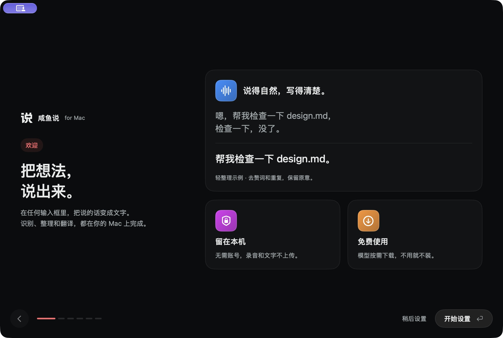
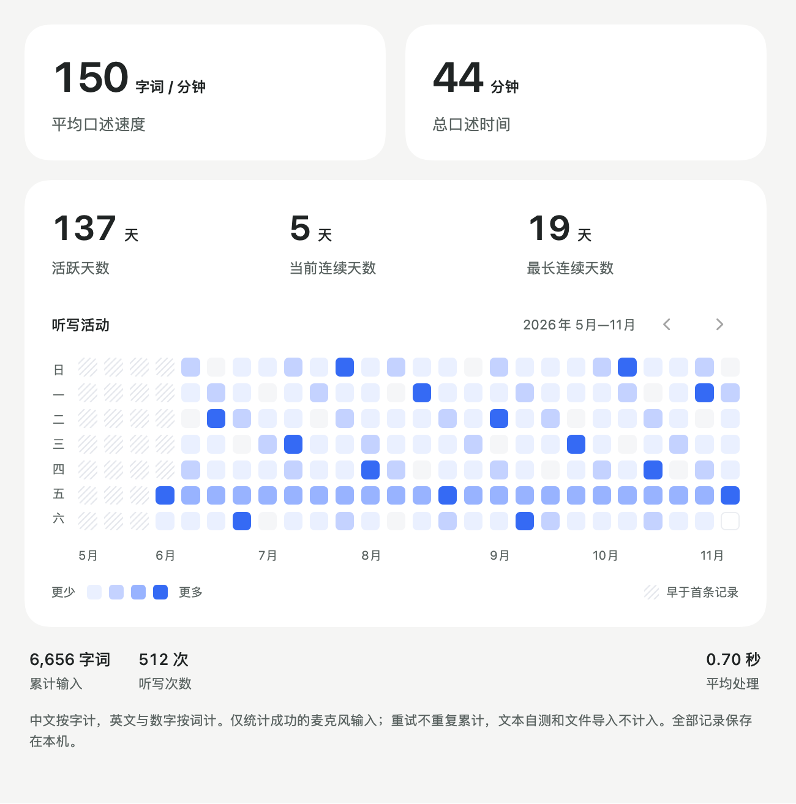

<p align="center">
  
</p>

<h1 align="center">咸鱼说 for Mac</h1>

<p align="center"><strong>把想法，说出来。</strong></p>
<p align="center">本地语音识别 · 可选 DeepSeek 整理 · Apple Silicon</p>

咸鱼说是一款免费的 macOS 菜单栏听写工具。按下右侧 Option 开始说话，再按一次结束。它在你的 Mac 上把语音转成文字，整理后尝试填入当前输入框。默认使用本地模型，无需账号或 API Key。也可在模型资源里选用 DeepSeek Flash 整理，密钥保存到 macOS 钥匙串。选择该模式时，待整理的文字会发送给 DeepSeek。

<p align="center">
  
</p>

## 能做什么

| 功能 | 用法 |
| --- | --- |
| **语音输入** | 默认右侧 Option，支持自定义快捷键、按住说话、长段录音和中英混输 |
| **三档整理** | 不整理保留原始识别。轻整理补标点、处理口吃和明确改口。结构化整理按语义分段，将独立事项排成 Markdown 编号列表 |
| **直接出英文** | 用独立快捷键把中文口述翻成英文，翻译模型按需下载 |
| **个人词表** | 给文件名、产品名和常用术语添加词条。检测到符合条件的手动改字时可提示加入 |
| **填入与恢复** | 尝试填入当前输入框。无法填入时可从本地历史找回，并按设置保留到剪贴板 |
| **录音与统计** | 录音胶囊显示阶段和音量。支持录音时自动静音、麦克风保温，以及按天查看听写活动 |

<p align="center">
  
  <br><sub>统计页的原生组件预览，使用模拟数据。</sub>
</p>

## 本地模型与数据

| 用途 | 模型 | 安装 |
| --- | --- | --- |
| 语音识别 | Qwen3-ASR-1.7B-8bit | 基础听写所需 |
| 文字整理 | Qwen3-1.7B-4bit | 使用本地轻整理或结构化整理时下载 |
| 英文翻译 | Hy-MT2-1.8B-4bit | 使用直接出英文时下载 |

模型下载完成后，识别、整理和翻译可离线运行。录音、文本、历史和个人词表默认存在本机的 `~/Library/Application Support/Dianyu`。模型下载和手动检查应用更新需要网络。DeepSeek 是可选的云端整理服务，仅在选中它且启用整理时发送本次转写及其中出现的词表写法。录音、语音识别和翻译均在本机处理。填入目标应用后的数据由该应用处理。

## 源码与构建

要求 Apple Silicon Mac 和 macOS 14 或更新版本。从源码编译还需要包含项目所用 SDK 的 Xcode 命令行工具、可搬移的 CPython 3.12 和 Sparkle 2.10.0。模型、运行时二进制和安装包不随源码仓库提供。

- [构建、运行与测试](Docs/build.md)
- [版本更新记录](CHANGELOG.md)
- [第三方组件与许可证](Resources/ThirdPartyNotices.txt)

```text
Sources/    原生 macOS 界面、录音、快捷键、写入和数据管理
Engine/     本地识别、整理、翻译和分段处理
Resources/  品牌资源、模型来源与校验清单
Tools/      构建、签名、打包与开发验证
Tests/      录音、界面、模型、文字整理与交付回归检查
```

项目源码的授权条款待定。第三方组件及模型适用各自的许可。
